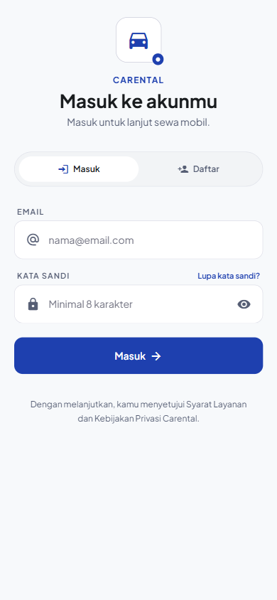
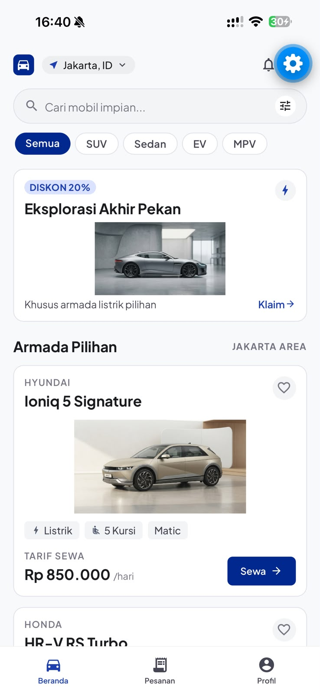
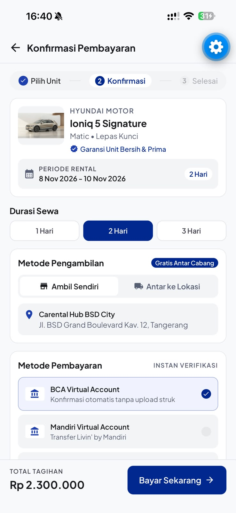
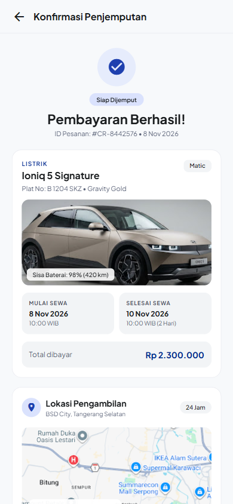
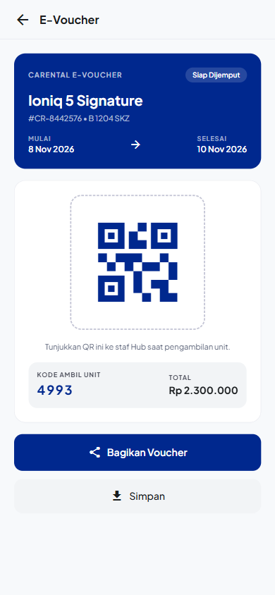
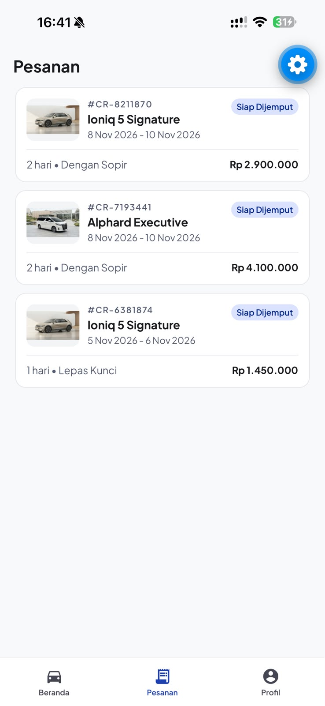
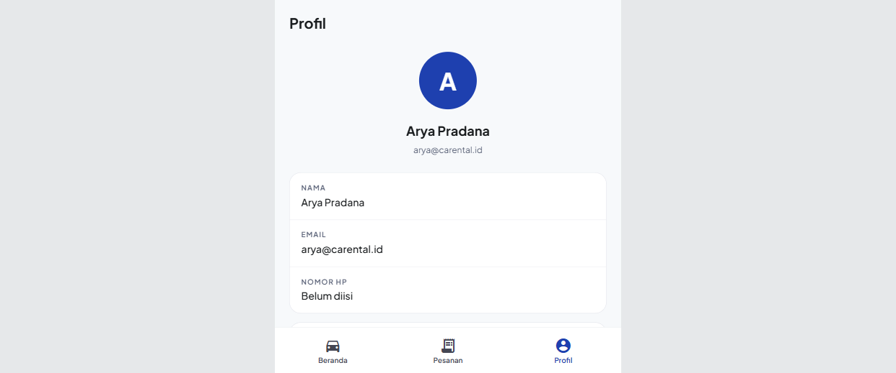
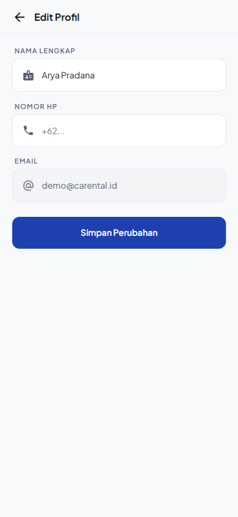
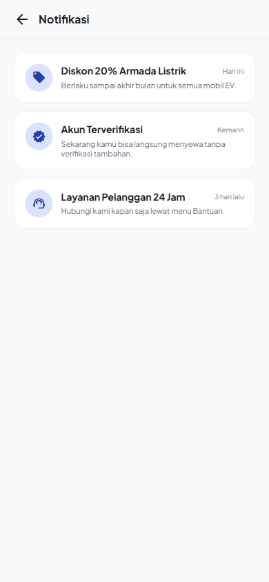

# Carental

## Identitas
- **Nama:** Abdullah Mudzakir
- **NIM:** 2702334512
- **Kampus:** BINUS @Semarang
- **Mata Kuliah:** COMP6923051 - Hybrid Application Development
- **Tema:** Transportation (Rental Mobil)
- **Nama Aplikasi:** Carental

## Deskripsi Singkat
Carental adalah prototipe aplikasi rental mobil berbasis React Native. Aplikasi ini dibuat untuk mempermudah pengguna mencari mobil, melihat detailnya, melakukan pemesanan sampai pembayaran, dan mendapatkan bukti pemesanan berupa e-voucher. Data mobil masih statis, sedangkan akun dan pesanan disimpan di penyimpanan lokal perangkat.

Fitur yang sudah jalan:
- Register dan login akun
- Beranda dengan pencarian dan filter kategori mobil
- Detail mobil lengkap dengan spesifikasi
- Pembayaran sewa (durasi, metode bayar, rincian biaya)
- Konfirmasi penjemputan dengan kode PIN
- E-voucher dengan QR
- Riwayat dan status pesanan
- Edit profil
- Notifikasi

## Tangkapan Layar

| Layar | Gambar |
|-------|--------|
| Masuk / Daftar |  |
| Beranda |  |
| Detail Mobil |  |
| Pembayaran |  |
| Konfirmasi Penjemputan |  |
| E-Voucher |  |
| Pesanan |  |
| Profil |  |
| Edit Profil |  |
| Notifikasi |  |

## Cara Menjalankan
```bash
git clone https://github.com/dzakirschool/cartal
cd cartal
npm install
npx expo start
```

Setelah muncul QR code:
- Scan pakai aplikasi Expo Go untuk Android, atau Camera untuk iPhone
- Tekan `w` untuk membuka versi web
- Tekan `a` untuk Android emulator

Catatan: aplikasi pertama kali dibuka harus daftar akun dulu, karena data akun disimpan di perangkat.

## Video Demo
Link video demo (YouTube/Google Drive): https://drive.google.com/file/d/1ZJqitkoYw0PQRCDU6obFh01SFySjyd_K/view?usp=sharing

---

## Jawaban Soal 6 - Penjelasan Konsep React Native

React Native adalah framework buatan Meta yang dipakai untuk membuat aplikasi mobile Android dan iOS menggunakan JavaScript. Cara kerjanya, kode JavaScript kita ditulis memakai komponen khusus seperti `View` dan `Text`, lalu React Native menerjemahkannya menjadi komponen native asli Android dan iOS. Jadi hasilnya bukan web yang dibungkus, tapi benar-benar komponen native. Di aplikasi Carental saya memakai React Native dengan Expo supaya setup dan testing di HP lebih cepat lewat Expo Go.

Keunggulan React Native untuk aplikasi hybrid antara lain:
1. Satu codebase bisa jalan di Android dan iOS sekaligus, jadi tidak perlu menulis dua aplikasi berbeda.
2. Pakai JavaScript/TypeScript sehingga bisa memakai ulang logika yang sama dengan web.
3. Ada fitur hot reload, jadi perubahan langsung terlihat tanpa build ulang.
4. Banyak library siap pakai, misalnya Expo Router untuk navigasi dan NativeWind untuk styling.

Konsep pertama adalah komponen. Komponen adalah potongan UI yang bisa dipakai berulang. Di project saya ada komponen reusable `KartuMobil` dan `InfoMobil`.

```tsx
type InfoMobilProps = {
  icon: keyof typeof MaterialIcons.glyphMap;
  label: string;
  nilai: string;
};

function InfoMobil({ icon, label, nilai }: InfoMobilProps) {
  return (
    <View>
      <MaterialIcons name={icon} size={22} color="#1E40AF" />
      <Text>{label}</Text>
      <Text>{nilai}</Text>
    </View>
  );
}
```

Konsep kedua adalah props. Props itu data yang dikirim dari komponen induk ke komponen anak, sifatnya read-only. Contohnya di halaman beranda saya mengirim data mobil ke `KartuMobil`:

```tsx
<KartuMobil key={mobil.id} mobil={mobil} />
```

Komponen `KartuMobil` menerimanya lewat parameter `mobil`, lalu menampilkan `mobil.nama` dan `mobil.harga`.

Konsep ketiga adalah state. State itu data yang bisa berubah dan kalau berubah, tampilan otomatis di-render ulang. Contohnya state pencarian dan filter di beranda:

```tsx
const [cari, setCari] = useState('');
const [kategori, setKategori] = useState('Semua');
```

Nilai `cari` dihubungkan ke `TextInput`, jadi setiap kali user mengetik, daftar mobil langsung terfilter tanpa reload halaman.

Konsep terakhir adalah navigasi. Saya memakai Expo Router yang berbasis file, artinya setiap file di folder `src/app` otomatis jadi halaman. Untuk pindah halaman saya pakai `router.push`, dan untuk mengambil parameter saya pakai `useLocalSearchParams`:

```tsx
router.push(`/mobil/${mobil.id}`);

const { id } = useLocalSearchParams<{ id: string }>();
const mobil = daftarMobil.find((item) => item.id === id);
```

Dengan empat konsep ini, aplikasi Carental bisa berjalan di Android, iOS, dan web dari satu kode yang sama.

---

## Jawaban Soal 8 - Analisis Kebutuhan

### Masalah
Proses sewa mobil masih sering manual: harus telepon atau datang ke tempat rental, harga dan ketersediaan unit tidak jelas, serta pembayaran dan bukti pemesanan tidak tercatat rapi. Pengguna butuh cara yang lebih cepat untuk melihat pilihan mobil, tahu harga, dan memesan langsung dari HP.

### Target Pengguna
- Usia 20-45 tahun
- Tinggal di kota besar dan butuh mobil untuk perjalanan atau liburan
- Terbiasa memakai aplikasi mobile untuk transaksi
- Butuh proses cepat dan informasi harga yang transparan

### Kebutuhan Pengguna
1. Pengguna bisa membuat akun dan login dengan mudah
2. Pengguna bisa mencari mobil dan memfilter sesuai kategori
3. Pengguna bisa melihat detail dan harga mobil secara jelas
4. Pengguna bisa memilih durasi, metode pengambilan, dan metode pembayaran
5. Pengguna bisa mendapatkan bukti pemesanan yang bisa ditunjukkan saat pengambilan
6. Pengguna bisa melihat riwayat pesanan yang pernah dibuat
7. Pengguna bisa mengubah data profilnya sendiri

### Pemetaan Kebutuhan ke Layar dan Komponen

| Kebutuhan | Layar | Komponen / File |
|-----------|-------|-----------------|
| Register & login | `src/app/index.tsx` | `AkunContext` |
| Cari & filter mobil | `src/app/(tabs)/beranda.tsx` | `KartuMobil`, `dataMobil` |
| Lihat detail mobil | `src/app/mobil/[id].tsx` | `InfoMobil` |
| Sewa & pilih pembayaran | `src/app/pembayaran.tsx` | `PesananContext` |
| Konfirmasi penjemputan | `src/app/penjemputan.tsx` | `PesananContext` |
| E-voucher | `src/app/voucher.tsx` | `PesananContext` |
| Riwayat & status pesanan | `src/app/(tabs)/pesanan.tsx` | `PesananContext` |
| Edit profil | `src/app/profil-edit.tsx` | `AkunContext`, `Avatar` |

### Alasan Keputusan Desain
- Warna biru dipakai sebagai warna utama karena memberi kesan terpercaya dan bersih, cocok untuk aplikasi transaksi.
- Tampilan dibuat minimalis dengan banyak ruang kosong supaya foto mobil jadi fokus utama.
- Navigasi memakai bottom tab supaya perpindahan antar halaman utama cepat dijangkau satu tangan.
- Harga selalu ditampilkan besar dan tebal supaya pengguna tidak bingung soal biaya.
- Tombol aksi utama pakai warna biru penuh supaya jelas mana langkah selanjutnya.

### Rencana Pengembangan
- Menghubungkan aplikasi ke backend supaya data akun dan pesanan tersimpan di server
- Menambahkan payment gateway asli supaya pembayaran benar-benar terproses
- Menambahkan peta untuk melacak posisi unit
- Menambahkan notifikasi push untuk status pesanan
- Menambahkan pilihan tanggal sewa yang lebih fleksibel dan fitur pembatalan pesanan

---

## Struktur Folder
```
src/
├─ app/          halaman (routing otomatis Expo Router)
├─ components/   komponen reusable
├─ constants/    data statis mobil
└─ context/      state global akun dan pesanan
```
